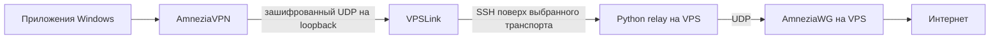

# VPSLink


[](https://github.com/JOOOOOJA/VPSLink/actions/workflows/ci.yml)
[](LICENSE)

**Windows 11 → ваш VPS → ваш AmneziaWG.** VPSLink переносит пакеты VPN через SSH, при необходимости используя встроенный WARP MASQUE и HTTPS/WebSocket-шлюз. Сетевой интерфейс и маршруты обслуживает отдельная AmneziaVPN. В интерфейсе доступны выбор стратегий winws, настройка постоянного шлюза и приглашения для других пользователей.

**Proof of Concept:** предназначен для самостоятельного тестирования. Работа зависит от провайдера, конфигурации VPS и версии AmneziaWG. VPSLink — самостоятельный проект, не официальный продукт Amnezia, Cloudflare, bol-van или Flowseal.

[Скачать](https://github.com/JOOOOOJA/VPSLink/releases) · [Изменения](CHANGELOG.md) · [Безопасность](SECURITY.md) · [Сообщить о проблеме](https://github.com/JOOOOOJA/VPSLink/issues)

## Содержание

- [Назначение](#назначение)
- [Архитектура и протокол](#архитектура-и-протокол)
- [Инфраструктура](#инфраструктура)
- [Первый запуск](#первый-запуск)
- [Постоянный шлюз](#постоянный-шлюз)
- [Стратегии winws](#стратегии-winws)
- [Приглашения](#приглашения)
- [Маршруты и диагностика](#маршруты-и-диагностика)
- [Изменения и хранение данных](#изменения-и-хранение-данных)
- [Обновления](#обновления)
- [Сборка и разработка](#сборка-и-разработка)
- [Лицензии](#лицензии)

## Назначение

Если прямое UDP-подключение AmneziaWG к VPS недоступно, Link предоставляет другой транспорт до того же сервера. Он обнаруживает существующий VPN, добавляет отдельного клиента либо импортирует готовый `.conf`, создаёт HTTPS-шлюз и экспортирует конфигурацию для AmneziaVPN.

Link **не устанавливает AmneziaWG на пустой VPS**. Для первоначальной настройки нужен хотя бы один работающий административный SSH-путь. Полностью недоступный сервер нельзя настроить «из ничего». Общего сервера, домена, VPN-ключей или регистрации WARP проекта в программе нет.

## Архитектура и протокол



| Путь | Цепочка до SSH | Условие применения |
|---|---|---|
| Прямой | TCP → SSH VPS | SSH доступен, UDP VPN не проходит |
| Прокси | SOCKS5 / HTTP CONNECT → SSH | Есть независимый доступный прокси |
| Адаптер | TCP через выбранный активный адаптер | Совместимый системный маршрут |
| Встроенный WARP | usque SOCKS loopback → MASQUE → SSH | WARP доступен, прямой IP VPS недоступен |
| HTTPS-шлюз | выбранный транспорт → WSS → Cloudflare Tunnel → SSH | Нужен постоянный HTTPS-вход |

При включённом встроенном ядре используется именно этот путь. `usque.exe` — отдельный процесс в SOCKS-режиме; `winws.exe` обрабатывает только исходящий IPv4 TCP/443 к MASQUE endpoint из регистрации устройства. Их бинарники проверяются по закреплённым контрольным суммам.

Протокол `TFL/1`: 4 байта длины big-endian, 1 байт типа и payload. `D` переносит датаграммы, `P` — heartbeat, `I` — инвентаризацию, `S` — UDP-назначение, `T` — статистику peer. `C`, `G`, `J` — административные операции создания VPN-клиента, шлюза и приглашений. Ключи получателей приглашений не имеют доступа к этим операциям. Размер кадра ограничен; локальный UDP слушает только `127.0.0.1`.

Windows OpenSSH проверяет закреплённый ED25519 fingerprint до передачи учётных данных. Agent forwarding и дополнительные port forwarding отключены. Пароль передаётся помощнику через именованный канал Windows с доступом текущего пользователя. Python relay владельца работает в SSH-сеансе; код получателя приглашения заранее установлен владельцем и не загружается из его SSH stdin.

Cloudflare завершает внешний TLS шлюза и видит соответствующие метаданные. Внутри остаются SSH и шифрование AmneziaWG. Владелец VPS/VPN остаётся доверенной стороной выхода в интернет. Перенос UDP через SSH/TCP создаёт head-of-line blocking при потерях: задержка, голос и скорость могут быть хуже нативного UDP. [Подробная архитектура](docs/architecture.md).

## Инфраструктура

| Компонент | Владельцу | Получателю приглашения | Где взять |
|---|---|---|---|
| Windows 11 x64 | Да | Да | Собственный ПК; ARM не тестировался |
| AmneziaVPN с поддержкой версии AWG сервера | Да | Да | [amnezia.org](https://amnezia.org), [документация](https://docs.amnezia.org) |
| Linux VPS, SSH, Python 3.8+ | Да | Нет | VPS у выбранного провайдера, с консолью восстановления |
| Работающий AmneziaWG | Да | Нет | Устанавливает владелец, например через AmneziaVPN |
| Административный SSH/root | Для настройки сервера и приглашений | Нет | Учётная запись владельца VPS |
| Домен и активная зона Cloudflare | Для постоянного HTTPS-шлюза | Нет | Домен у регистратора, NS делегированы Cloudflare |
| Отдельная регистрация WARP | Для встроенного режима | Для встроенного режима | При первом подключении после согласия с условиями Cloudflare |

Автоматический шлюз рассчитан на Linux x64 с systemd. Windows OpenSSH Client должен быть установлен как компонент Windows. Setup устанавливает .NET Desktop Runtime, если подходящего x64 runtime нет. Portable-архив распаковывается целиком и требует runtime отдельно. AmneziaVPN установщик не устанавливает.

Домен нужен только владельцу постоянного шлюза: отдельный домен на каждого человека и Cloudflare API-токен у получателей не требуются. VPS и домен приобретаются у выбранных вами провайдеров; проект не продаёт инфраструктуру.

## Первый запуск

1. Установите `VPSLink-0.4.0-Setup.exe` из [Releases](https://github.com/JOOOOOJA/VPSLink/releases) и совместимую AmneziaVPN. Контрольные суммы файлов доступны в `SHA256SUMS.txt`.
2. Добавьте VPS: адрес, SSH-порт, пользователя, пароль или ключ. ED25519-отпечаток сверьте через доверенную консоль хостера.
3. Выберите путь. При первом подключении встроенного WARP программа предложит регистрацию отдельного устройства. Запуск winws потребует прав администратора для WinDivert.
4. Нажмите **Подключить**, выберите найденный AmneziaWG и создание клиента либо импорт готового `.conf`.
5. После готовности моста нажмите **Сохранить профиль VPN…**, импортируйте файл в AmneziaVPN и включите его. Для повторных подключений используйте постоянный локальный порт.
6. Проверьте VPN, затем **Проверить интернет** и обычные приложения.

Порядок ручного подключения: **VPSLink → мост → AmneziaVPN**. Отключение: **AmneziaVPN → мост**. Сворачивание в трей сохраняет работающий мост; для выхода используйте меню трея. Не включайте одновременно исходный и локальный профили с одним VPN-ключом. Встроенная вкладка **Инструкция** открывает также локальную HTML-версию в браузере.

## Постоянный шлюз

**Подключение → Постоянный шлюз…**: активная зона Cloudflare, свободный поддомен вроде `link.example.com`, API-токен с правами:

- Account / Cloudflare Tunnel / Edit — только нужный аккаунт;
- Zone / DNS / Edit и Zone / Zone / Read — только нужная зона.

Мастер создаёт именованный tunnel, CNAME, устанавливает проверенный cloudflared и две systemd-службы на VPS. Чужая DNS-запись не заменяется. Новый адрес сохраняется после проверки SSH через него. API-токен управления не сохраняется; токен конкретного cloudflared tunnel остаётся на VPS. Случайный bearer-токен HTTPS-relay не заменяет SSH-аутентификацию.

Делегирование NS, покупка домена и первоначальный доступ к VPS остаются задачами владельца. [Файлы, службы, права и удаление](docs/server-changes.md).

## Стратегии winws

По умолчанию используется [Flowseal/zapret-discord-youtube](https://github.com/Flowseal/zapret-discord-youtube), альтернативно — [bol-van/zapret-win-bundle](https://github.com/bol-van/zapret-win-bundle). VPSLink адаптирует совместимые TLS-секции для собственного канала WARP.

- Шесть встроенных вариантов, обновление каталога, проверка выбранного и последовательный подбор.
- Стратегия сохраняется отдельно для сервера; загрузка каталога не переключает действующее соединение.
- Загружаемые файлы ограничены по размеру и закреплены за одной ревизией upstream; проверяются Git blob hash, имена шаблонов и допустимые параметры.
- BAT/CMD **не исполняются**, службы upstream не устанавливаются. TCP timestamps Windows не изменяются; требующие их варианты пропускаются с пояснением.
- Исходные hostlist/ipset/UDP-фильтры не копируются: захват ограничен одним MASQUE IPv4 и TCP/443. Это адаптация секций, а не запуск полного профиля Flowseal.
- Для проверки и подбора пользователь сначала останавливает VPN/мост и конфликтующие WARP/winws/usque. Программа не выключает их автоматически.

Успех подбора подтверждает путь до VPS и SSH-ключ. VPN и интернет проверяются после обычного подключения. Количество совместимых вариантов зависит от ревизии upstream. [Техническое описание и ограничения](docs/strategies.md).

## Приглашения

1. Владелец выбирает настроенный сервер/root-профиль и самостоятельно останавливает VPN и мост.
2. В **Приглашениях** нажимает **Создать приглашение…**, задаёт имя, пароль от 12 символов и сохраняет `.vpslink`.
3. Передаёт файл получателю, пароль — отдельно. Каждому устройству создаётся своё приглашение.
4. Получатель импортирует файл, сверяет адрес/отпечаток, при необходимости регистрирует своё устройство WARP, подключает мост и сохраняет свой `.conf` для AmneziaVPN.

В файл входят **новый VPN peer**, отдельный ограниченный SSH-ключ, адрес/отпечаток сервера и токен доступа к HTTPS-relay, если он используется. Пароль SSH владельца, его SSH/VPN-ключи, API-токен Cloudflare и токен cloudflared **не передаются**. Используется отдельная схема переноса, не экспорт внутреннего `profiles.json`.

Ключ получателя установлен в root `authorized_keys` с `restrict,command=...`. Фиксированный обработчик разрешает один UDP endpoint и статистику своего peer, запрещает shell/forwarding, административные команды и исполнение присланного кода. Это ограниченный SSH-ключ, **не отдельная ОС-учётная запись или контейнер**. Обработчик выполняется с root-правами; эта экспериментальная часть требует особого внимания при аудите.

**Отозвать выбранное…** отключает транспорт, удаляет VPN peer из конфига и работающего интерфейса. Если удаление peer не подтверждено, UI сообщает о возможном сохранении прямого VPN-доступа и предлагает повторить отзыв. Один файл, скопированный нескольким людям, не даёт отдельных идентичностей и раздельного отзыва.

Файл защищён AES-256-GCM; PBKDF2-HMAC-SHA256, 310000 итераций, случайные salt/nonce. Пароль должен быть достаточно сильным: файл с известным паролем даёт доступ получателя. [Формат, восстановление после сбоя, отзыв и границы](docs/sharing.md).

## Маршруты и диагностика

Маршруты устанавливает AmneziaVPN согласно `AllowedIPs`. При экспорте IPv4 MASQUE исключается из VPN, чтобы внешний транспорт не замкнулся сам на себя. Поэтому «каждый пакет Windows через VPS» — неточное обещание: внешний транспорт должен иметь независимый маршрут.

| Статус | Подтверждено | Ещё не подтверждено |
|---|---|---|
| Мост готов | SSH и UDP-сокет до VPN | Handshake и интернет |
| VPN проверен | Свежий handshake, двусторонние UDP, рост счётчиков выбранного peer | Все приложения, DNS/IPv6 |
| Интернет проверен | Конкретный HTTPS-запрос через IPv4 VPN-интерфейс | Все виды утечек и kill switch |

Собственного kill switch нет. Split tunneling, расширения браузера, системный WARP и другие фильтры могут менять маршрут. Проверяйте IPv4, DNS, IPv6 и приложения отдельно.

| Симптом | Что проверить |
|---|---|
| Не открывается локальный UDP | Занятый/зарезервированный порт; после смены заново экспортировать `.conf` |
| Мост готов, VPN молчит | Совпадение loopback-порта, AWG-версии, peer и сервера |
| SSH fingerprint изменился | Проверить через консоль хостера, не принимать автоматически |
| Вариант стратегии пропущен | Причину импорта в каталоге; это не всегда ошибка подключения |
| VPN отвечает, сайты нет | Маршруты, split tunneling, браузерный прокси, DNS, NAT на VPS |
| Приглашение не создаётся | Root-доступ, выбранный поддерживаемый AWG, остановленные VPN/мост; обновить список для восстановления после сбоя |

В issue не прикладывайте секреты. [Что проверено для 0.4.0](docs/validation-0.4.0.md).

## Изменения и хранение данных

| Область | Действия |
|---|---|
| Windows | Файлы программы и ярлыки; дочерние OpenSSH/usque/winws; WinDivert для встроенной стратегии |
| Профили | Атомарная запись с резервной копией, DPAPI-защита секретов, постоянный локальный UDP-порт |
| VPS VPN | Добавление peer, свободного адреса, сохранение AWG-конфига с резервной копией, применение runtime |
| Шлюз | cloudflared, loopback relay, systemd-службы, tunnel/CNAME |
| Приглашения | Ограниченные строки `authorized_keys`, `/root/.vpslink-shares/<id>/`, отдельный VPN peer |

Данные находятся в `%LOCALAPPDATA%\ThingsNotFun-Link`. Историческое имя каталога и AppId сохранены для обновления старых установок без потери серверов. DPAPI привязывает секреты к текущему пользователю Windows; копирование `profiles.json` не является способом выдачи доступа другому человеку. Регистрация usque содержит отдельный ключ устройства.

Экспортированный `.conf` содержит приватный ключ в открытом виде. `.vpslink` зашифрован, но также является секретом. Не публикуйте файлы регистрации WARP, приглашения, профили, ключи, токены, личные адреса инфраструктуры или дампы процессов.

Сетевые обращения: заданный VPS/прокси/шлюз; Cloudflare для выбранного WARP/tunnel; GitHub для обновлений приложения/каталога; диагностический HTTPS endpoint при проверке интернета. Централизованной отправки журнала разработчику нет. [Модель безопасности](docs/security-model.md).

Удаление приложения сохраняет личные профили и не удаляет VPS/контейнер/шлюз/получателей. Сначала отзовите ненужные приглашения, серверные ресурсы удаляйте отдельно по [инструкции](docs/server-changes.md).

## Обновления

Источник — только `JOOOOOJA/VPSLink`, включая PoC prerelease-канал. Проверяются версия, имя/размер установщика, разрешённые HTTPS-хосты и SHA-256 из метаданных GitHub. Проверка/загрузка не меняют действующее соединение. Установку запускает пользователь после закрытия VPN и Link; обновление поверх сохраняет профили.

Контрольные суммы формируются сборкой релиза, **не требуются от авторов PR** и не заменяют доверие к GitHub/каналу доставки. Подмена файла вместе с его метаданными в захваченном репозитории остаётся угрозой.

## Сборка и разработка

C# / Windows Forms, target `net6.0-windows`, `RollForward=LatestMajor`. Текущий build использует .NET 6 SDK; эта ветка уже вышла из поддержки, миграция target остаётся технической задачей. Сервер использует Python standard library, генератор ключей написан на Go.

```powershell
.\tools\Build.ps1
.\tools\Build.ps1 -WarpCoreDirectory <usque-directory> -ZapretDirectory <zapret-directory>
.\tools\Test-Publication.ps1
.\tools\Build-Installer.ps1 -Compiler <path-to-ISCC.exe>
```

NuGet-источники отключены. Build не скачивает runtime-компоненты: для полной сборки зависимости и corresponding sources LGPL-компонентов подготавливаются отдельно и сверяются с манифестами. CI проверяет Windows-код и Python на Linux без рабочего VPS/секретов. [Сборка](docs/build.md), [сторонние компоненты](docs/third-party-build.md).

PR должен описывать проблему, поведение и проведённую проверку. Для сетевых изменений нужны тесты отказов и восстановления. Не прикладывайте готовые EXE, личные конфиги или токены. [CONTRIBUTING.md](CONTRIBUTING.md).

## Лицензии

Код VPSLink — [MIT](LICENSE). usque, zapret/winws, Flowseal presets, WinDivert, Cygwin, Go и .NET сохраняют собственные условия; MIT проекта их не заменяет. [Уведомления](THIRD_PARTY_NOTICES.md), [лицензии](LICENSES).

Релиз включает соответствующие исходники сторонних компонентов и материалы сборки, в частности для LGPL. Обновление каталога стратегий не обновляет winws/WinDivert: их версии меняются отдельно с проверкой совместимости и лицензий.
