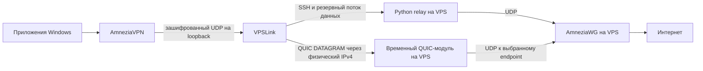

# VPSLink


[](https://github.com/JOOOOOJA/VPSLink/actions/workflows/ci.yml)
[](LICENSE)

**Windows → ваш VPS → ваш AmneziaWG.** Если AmneziaVPN не может подключиться к вашему серверу напрямую, откройте мост в VPSLink и включите VPN в AmneziaVPN. Мост передаёт пакеты через прямой QUIC DATAGRAM или через SSH с поддержкой WARP MASQUE и HTTPS/WebSocket-шлюза. В VPSLink вы можете настроить постоянный адрес шлюза, подобрать стратегию winws и выдать приглашение. Чтобы Steam, игры или выбранные приложения выходили через провайдера, настройте их в разделе **Напрямую**.

**Proof of Concept:** предназначен для самостоятельного тестирования. Работа зависит от провайдера, конфигурации VPS и версии AmneziaWG. VPSLink — самостоятельный проект, не официальный продукт Amnezia, Cloudflare, bol-van или Flowseal.

[Скачать](https://github.com/JOOOOOJA/VPSLink/releases/latest) · [Изменения](CHANGELOG.md) · [Безопасность](SECURITY.md) · [Сообщить о проблеме](https://github.com/JOOOOOJA/VPSLink/issues)

## Содержание

- [Назначение](#назначение)
- [Архитектура и протокол](#архитектура-и-протокол)
- [Инфраструктура](#инфраструктура)
- [Первый запуск](#первый-запуск)
- [Выбор транспорта](#выбор-транспорта)
- [Постоянный шлюз](#постоянный-шлюз)
- [Стратегии winws](#стратегии-winws)
- [Приглашения](#приглашения)
- [Если вам прислали приглашение](#если-вам-прислали-приглашение)
- [Приложения напрямую](#приложения-напрямую)
- [Маршруты и диагностика](#маршруты-и-диагностика)
- [Изменения и хранение данных](#изменения-и-хранение-данных)
- [Обновления](#обновления)
- [Сборка и разработка](#сборка-и-разработка)
- [Лицензии](#лицензии)

## Назначение

Подготовьте свой VPS с работающим AmneziaWG и проверьте административный доступ по SSH. В VPSLink выберите найденный VPN и создайте отдельного клиента либо импортируйте готовый `.conf`. Сохраните профиль для AmneziaVPN и при необходимости настройте HTTPS-шлюз. Для встроенного WARP зарегистрируйте своё устройство при первом подключении.

## Архитектура и протокол



| Путь | Цепочка до SSH | Условие применения |
|---|---|---|
| Прямой | TCP → SSH VPS | SSH доступен, UDP VPN не проходит |
| Прокси | SOCKS5 / HTTP CONNECT → SSH | Есть независимый доступный прокси |
| Адаптер | TCP через выбранный активный адаптер | Совместимый системный маршрут |
| Встроенный WARP | usque SOCKS loopback → MASQUE → SSH | WARP доступен, прямой IP VPS недоступен |
| HTTPS-шлюз | выбранный транспорт → WSS → Cloudflare Tunnel → SSH | Нужен постоянный HTTPS-вход |

Для WARP-пути `usque.exe` работает в отдельном процессе в SOCKS-режиме. `winws.exe` обрабатывает только исходящий IPv4 TCP/443 к MASQUE endpoint из регистрации устройства. Их бинарники проверяются по закреплённым контрольным суммам.

Протокол `TFL/1`: 4 байта длины big-endian, 1 байт типа и payload. `D` переносит датаграммы, `P` — heartbeat, `I` — инвентаризацию, `S` — UDP-назначение, `T` — статистику peer. `C`, `G`, `J` — административные операции создания VPN-клиента, шлюза и приглашений. Ключи получателей приглашений не имеют доступа к этим операциям. Размер кадра ограничен; локальный UDP по умолчанию слушает `127.0.0.1`.

Комплектный Win32 OpenSSH проверяет закреплённый отпечаток ED25519 до передачи учётных данных. Agent forwarding и дополнительные port forwarding отключены. Пароль передаётся помощнику через именованный канал Windows с доступом текущего пользователя. Python relay владельца работает в SSH-сеансе. Код получателя приглашения заранее установлен владельцем.

Cloudflare завершает внешний TLS шлюза и видит соответствующие метаданные. Внутри остаются SSH и шифрование AmneziaWG. Владелец VPS/VPN остаётся доверенной стороной выхода в интернет. Перенос UDP через SSH/TCP создаёт head-of-line blocking при потерях: задержка, голос и скорость могут быть хуже нативного UDP. [Подробная архитектура](docs/architecture.md).

## Инфраструктура

| Компонент | Владельцу | Получателю приглашения | Где взять |
|---|---|---|---|
| Windows 10 x64 (сборка 19044 или новее) либо Windows 11 x64 | Да | Да | На Windows 10 нужна сборка VPSLink с комплектным SSH-клиентом |
| AmneziaVPN с поддержкой версии AWG сервера | Да | Да | [amnezia.org](https://amnezia.org), [документация](https://docs.amnezia.org) |
| Linux VPS, SSH, Python 3.8+ | Да | Нет | VPS у выбранного провайдера, с консолью восстановления |
| Работающий AmneziaWG | Да | Нет | Устанавливает владелец, например через AmneziaVPN |
| Административный SSH/root | Для настройки сервера и приглашений | Нет | Учётная запись владельца VPS |
| Домен и активная зона Cloudflare | Для постоянного HTTPS-шлюза | Нет | Домен у регистратора, NS делегированы Cloudflare |
| Отдельная регистрация WARP | Для встроенного режима | Для встроенного режима | При первом подключении после согласия с условиями Cloudflare |

Для автоматической настройки шлюза используйте Linux x64 с systemd. Установите AmneziaVPN отдельно. Setup проверит наличие .NET Desktop Runtime и установит его при необходимости. Если скачали portable-архив, распакуйте его целиком вместе с папкой `openssh` и установите подходящий x64 runtime.

Если настраиваете постоянный шлюз, подготовьте свой домен и доступ к его зоне Cloudflare. Если подключаетесь по приглашению, возьмите у владельца файл и пароль к нему. VPS арендуйте у хостера, домен зарегистрируйте у выбранного вами регистратора.

## Первый запуск

1. Для проверки на Windows 10 войдите в GitHub, откройте последний успешный запуск [Windows 10 test package](https://github.com/JOOOOOJA/VPSLink/actions/workflows/windows10-test.yml?query=branch%3Atest%2Fwindows-10) и скачайте `VPSLink-Windows10-x64-test` из раздела **Artifacts**. Распакуйте архив и запустите `VPSLink-0.5.2-Setup.exe`. Установите совместимую AmneziaVPN отдельно.
2. Добавьте VPS: адрес, SSH-порт, пользователя, пароль или ключ. ED25519-отпечаток сверьте через доверенную консоль хостера.
3. Выберите путь. При первом подключении встроенного WARP программа предложит регистрацию отдельного устройства. Запуск winws потребует прав администратора для WinDivert.
4. Нажмите **Подключить**, выберите найденный AmneziaWG и создание клиента либо импорт готового `.conf`.
5. После готовности моста нажмите **Сохранить профиль VPN…**, импортируйте файл в AmneziaVPN и включите его. Для повторных подключений используйте постоянный локальный порт.
6. Проверьте VPN, затем **Проверить интернет** и обычные приложения.

Подключайте сначала мост VPSLink, затем профиль в AmneziaVPN. При отключении начните с AmneziaVPN. Чтобы оставить мост работать, сверните VPSLink в трей. Для полного выхода воспользуйтесь меню трея. Если у исходного и локального профилей один VPN-ключ, включайте их по очереди. Локальную инструкцию для браузера откройте во вкладке **Инструкция**.

## Выбор транспорта

Выберите сервер, откройте **Подключение** и выберите режим перед запуском моста. Там же отображается активный путь.

| Режим | Скорость и задержка | Доступность и видимость |
|---|---|---|
| **Авто · QUIC с резервом** | Начинает с прямого QUIC, сохраняет локальный порт при переходе | Нужны встроенный WARP и настроенный HTTPS-шлюз |
| **Только прямой QUIC** | Потеря датаграммы не задерживает доставку следующих датаграмм ради её повтора | Нужен доступ к временному UDP-порту Linux x64 VPS. Провайдер видит IP VPS |
| **Только WARP + HTTPS** | Голос и игры могут испытывать скачки задержки под нагрузкой SSH/TCP | Резерв при блокировке прямого UDP или IP VPS, пока доступны WARP и шлюз. С ПК соединение идёт к Cloudflare |
| **Из настроек сервера** | Использует сохранённый путь SSH | Режим ранее сохранённых профилей и приглашений |

Оба новых пути сохраняют шифрование AmneziaWG и проверку ключа SSH. QUIC дополнительно проверяет сертификат временного модуля по отпечатку из защищённого SSH-сеанса. Для управления VPS SSH может использовать HTTPS-шлюз даже при прямом QUIC для данных. Режим **Авто** остаётся на рабочем резерве до отключения. При следующем запуске моста он заново проверяет QUIC. Во время перехода возможна короткая пауза, ранее импортированный профиль AmneziaVPN подходит для обоих путей. [Подробная архитектура](docs/architecture.md).

В одном сравнении со стримом прямой QUIC снизил пики задержки при отдаче, а WARP + HTTPS обеспечил более высокую скорость скачивания. [Методика и результаты](docs/validation-0.5.1.md).

## Постоянный шлюз

**Подключение → Постоянный шлюз…**: активная зона Cloudflare, свободный поддомен вроде `link.example.com`, API-токен с правами:

- Account / Cloudflare Tunnel / Edit — только нужный аккаунт;
- Zone / DNS / Edit и Zone / Zone / Read — только нужная зона.

Мастер создаёт именованный tunnel, CNAME, устанавливает проверенный cloudflared и две systemd-службы на VPS. Чужая DNS-запись не заменяется. Новый адрес сохраняется после проверки SSH через него. API-токен управления не сохраняется; токен конкретного cloudflared tunnel остаётся на VPS. Случайный bearer-токен HTTPS-relay не заменяет SSH-аутентификацию.

Делегирование NS, покупка домена и первоначальный доступ к VPS остаются задачами владельца. [Файлы, службы, права и удаление](docs/server-changes.md).

## Стратегии winws

Если встроенный WARP не соединяется, откройте **Стратегии** и выберите один из шести встроенных вариантов либо обновите каталог с GitHub. Источник по умолчанию — [Flowseal/zapret-discord-youtube](https://github.com/Flowseal/zapret-discord-youtube). В списке доступен и [bol-van/zapret-win-bundle](https://github.com/bol-van/zapret-win-bundle).

1. Обновите каталог, когда вам удобно. VPSLink загружает варианты без переключения текущего подключения. Количество доступных стратегий зависит от выбранной ревизии источника.
2. Перед проверкой или подбором отключите профиль AmneziaVPN, затем мост VPSLink. Если запущены внешний winws/zapret, системный WARP или другой usque, остановите их перед запуском проверки.
3. Нажмите **Проверить выбранную** или **Подобрать автоматически**. Успешная проверка подтверждает путь до вашего VPS и совпадение SSH-ключа.
4. Нажмите **Использовать для сервера**, подключите мост и включите прежний профиль AmneziaVPN. Проверьте VPN и выход в интернет. Выбранная стратегия сохраняется для этого сервера.

VPSLink читает BAT/CMD как данные и адаптирует совместимые TLS-параметры и шаблоны пакетов под встроенный WARP. Фильтр winws захватывает только исходящий TCP/443 к IPv4-адресу WARP MASQUE. При загрузке VPSLink проверяет ревизию Git, Git blob hash, размер файлов, имена шаблонов и разрешённые параметры. Если вариант требует TCP timestamps, посмотрите причину пропуска под каталогом. [Техническое описание импорта и проверки](docs/strategies.md).

## Приглашения

**Чтобы выдать доступ**

1. Выберите настроенный сервер с доступом по SSH от root. Отключите профиль AmneziaVPN, затем мост VPSLink.
2. В **Приглашениях** нажмите **Создать приглашение…**, введите имя и пароль от 12 символов. Сохраните файл `.vpslink`.
3. Передайте получателю файл и отдельно сообщите пароль. Создавайте своё приглашение для каждого устройства, которому хотите выдать доступ отдельно.

В файл входят **новый VPN peer**, отдельный ограниченный SSH-ключ, адрес/отпечаток сервера и токен доступа к HTTPS-relay, если он используется. Пароль SSH владельца, его SSH/VPN-ключи, API-токен Cloudflare и токен cloudflared **не передаются**. Используется отдельная схема переноса, не экспорт внутреннего `profiles.json`.

Ключ получателя установлен в root `authorized_keys` с `restrict,command=...`. Фиксированный обработчик разрешает один UDP endpoint и статистику своего peer, запрещает shell/forwarding, административные команды и исполнение присланного кода. Сам обработчик работает с правами root. При аудите учитывайте, что получатель запускает его на вашем VPS через ограниченный SSH-ключ.

Чтобы закрыть доступ, выберите получателя и нажмите **Отозвать выбранное…**. VPSLink отключит транспорт и удалит VPN peer из конфига и работающего интерфейса. Если приложение сообщает, что прямой VPN-доступ мог сохраниться, повторите отзыв. Все копии одного файла используют один peer и отзываются вместе.

### Если вам прислали приглашение

1. Получите у владельца файл `.vpslink` и отдельно пароль к нему. Установите VPSLink и [AmneziaVPN](https://amnezia.org) с поддержкой версии AmneziaWG на сервере.
2. В VPSLink откройте **Приглашения → Импортировать приглашение…**. Выберите `.vpslink`, введите пароль и сверьте показанные адрес сервера и отпечаток SSH с владельцем перед подтверждением.
3. Выберите добавленный сервер и нажмите **Подключить**. Если программа предложит регистрацию вашего устройства WARP, выполните её и дождитесь готовности моста.
4. В разделе **Серверы** нажмите **Сохранить профиль VPN…**. Импортируйте полученный `.conf` в AmneziaVPN и включите его. Вернитесь на главный экран VPSLink и нажмите **Проверить интернет**.
5. При следующем запуске сначала подключите VPSLink, затем включите тот же профиль в AmneziaVPN. Если подключаете второй компьютер, попросите отдельное приглашение.

Пароль к приглашению нужен при импорте. Храните `.vpslink`, пароль и экспортированный `.conf` у себя. Если импорт прошёл, а мост или VPN не подключается, сообщите владельцу, на каком шаге появилась ошибка.

Файл защищён AES-256-GCM; PBKDF2-HMAC-SHA256, 310000 итераций, случайные salt/nonce. Пароль должен быть достаточно сильным: файл с известным паролем даёт доступ получателя. [Формат, восстановление после сбоя, отзыв и границы](docs/sharing.md).

## Приложения напрямую

Настройте **Напрямую → Настроить список…** для выбранного сервера. Отдельно можно включить **Steam и игры**, подхватить список **исключений AmneziaVPN** и добавить `.exe`. Список Amnezia перечитывается при запуске режима. Поддерживаются исключения, заданные путём к Windows-приложению.

Первый раз выберите официальный архив [sing-box 1.14.4 для Windows amd64](https://github.com/SagerNet/sing-box/releases/tag/v1.14.4). Нужен полный IPv4-профиль AmneziaWG и один физический шлюз Windows. В AmneziaVPN вручную выключите разделение по приложениям, по сайтам и KillSwitch, затем переподключите VPN. После отключения KillSwitch трафик может идти напрямую при обрыве VPN.

Подключите VPSLink, затем AmneziaVPN. Дождитесь статуса прямого маршрута и перезапустите выбранные приложения. Сетевой адаптер sing-box запускается после подтверждения VPN и работает, пока доступен этот мост. Остальные программы сохраняют выход через VPN. [Настройка, ограничения и диагностика](docs/direct-routing.md).

## Маршруты и диагностика

Маршруты устанавливает AmneziaVPN согласно `AllowedIPs`. При экспорте IPv4 MASQUE исключается из VPN, чтобы внешний транспорт не замкнулся сам на себя. Поэтому «каждый пакет Windows через VPS» — неточное обещание: внешний транспорт должен иметь независимый маршрут.

| Статус | Подтверждено | Ещё не подтверждено |
|---|---|---|
| Мост готов | SSH и UDP-сокет до VPN | Handshake и интернет |
| VPN проверен | Свежий handshake, двусторонние UDP, рост счётчиков выбранного peer | Все приложения, DNS/IPv6 |
| Интернет проверен | Конкретный HTTPS-запрос через IPv4 VPN-интерфейс | Все виды утечек и kill switch |

Собственного kill switch нет. Split tunneling, расширения браузера, системный WARP и другие фильтры могут менять маршрут. Проверяйте IPv4, DNS, IPv6 и приложения отдельно.

| Симптом | Что проверить |
|---|---|
| Не открывается локальный UDP | Проверьте, свободен ли порт. Если сменили порт, заново сохраните и импортируйте `.conf`. |
| Мост готов, VPN молчит | Сверьте локальный порт, версию AWG, выбранный сервер и peer. |
| SSH fingerprint изменился | Сверьте новый отпечаток через консоль хостера перед подтверждением. |
| Вариант стратегии пропущен | Откройте причину пропуска под каталогом. |
| VPN отвечает, сайты нет | Проверьте маршруты, раздельное туннелирование, браузерный прокси, DNS и NAT на VPS. |
| Приглашение не создаётся | Проверьте root-доступ и версию AWG. Отключите VPN и мост. Если создание оборвалось, обновите список приглашений. |

В issue не прикладывайте секреты. [Что проверено для 0.4.0](docs/validation-0.4.0.md) · [Проверка разделения трафика](docs/direct-routing.md#проверка).

## Изменения и хранение данных

| Область | Действия |
|---|---|
| Windows | Файлы программы и ярлыки; дочерние OpenSSH/usque/winws; WinDivert для встроенной стратегии; sing-box TUN при включённом прямом режиме |
| Профили | Атомарная запись с резервной копией, DPAPI-защита секретов, постоянный локальный UDP-порт |
| VPS VPN | Добавление peer, свободного адреса, сохранение AWG-конфига с резервной копией, применение runtime |
| Шлюз | cloudflared, loopback relay, systemd-службы, tunnel/CNAME |
| Приглашения | Ограниченные строки `authorized_keys`, `/root/.vpslink-shares/<id>/`, отдельный VPN peer |

Данные находятся в `%LOCALAPPDATA%\ThingsNotFun-Link`. Историческое имя каталога и AppId сохранены для обновления старых установок без потери серверов. DPAPI привязывает секреты к текущему пользователю Windows; копирование `profiles.json` не является способом выдачи доступа другому человеку. Регистрация usque содержит отдельный ключ устройства.

Экспортированный `.conf` содержит приватный ключ в открытом виде. `.vpslink` зашифрован, но также является секретом. Не публикуйте файлы регистрации WARP, приглашения, профили, ключи, токены, личные адреса инфраструктуры или дампы процессов.

Сетевые обращения: заданный VPS/прокси/шлюз; Cloudflare для выбранного WARP/tunnel; GitHub для обновлений приложения/каталога; диагностический HTTPS endpoint при проверке интернета. Централизованной отправки журнала разработчику нет. [Модель безопасности](docs/security-model.md).

Удаление приложения сохраняет личные профили и не удаляет VPS/контейнер/шлюз/получателей. Сначала отзовите ненужные приглашения, серверные ресурсы удаляйте отдельно по [инструкции](docs/server-changes.md).

## Обновления

Откройте **Обновления** и скачайте новую версию при работающем VPN. VPSLink проверит версию, имя и размер установщика, разрешённые HTTPS-хосты и SHA-256. Источник — репозиторий `JOOOOOJA/VPSLink`, включая предварительные версии Proof of Concept.

Когда файл скачан, отключите профиль AmneziaVPN, затем мост VPSLink. Нажмите **Установить и закрыть Link** и подтвердите запрос Windows. Установщик обновит текущую копию и сохранит ваши профили. После установки подключите мост и включите прежний профиль AmneziaVPN.

Контрольные суммы формируются сборкой релиза, **не требуются от авторов PR** и не заменяют доверие к GitHub/каналу доставки. Подмена файла вместе с его метаданными в захваченном репозитории остаётся угрозой.

## Сборка и разработка

C# / Windows Forms, target `net6.0-windows`, `RollForward=LatestMajor`. Текущий build использует .NET 6 SDK; эта ветка уже вышла из поддержки, миграция target остаётся технической задачей. Серверный SSH-релей использует стандартную библиотеку Python. Генератор ключей и модули QUIC написаны на Go.

```powershell
.\tools\Build.ps1
.\tools\Build.ps1 -WarpCoreDirectory <usque-directory> -ZapretDirectory <zapret-directory>
.\tools\Test-Publication.ps1
.\tools\Build-Installer.ps1 -Compiler <path-to-ISCC.exe>
```

NuGet-источники отключены. Сборка QUIC использует Go-модули с закреплёнными версиями и контрольными суммами. Для полной сборки runtime-компоненты и соответствующие исходники LGPL-компонентов подготавливаются отдельно и сверяются с манифестами. CI проверяет Windows-код и Python на Linux без рабочего VPS и секретов. [Сборка](docs/build.md), [сторонние компоненты](docs/third-party-build.md).

PR должен описывать проблему, поведение и проведённую проверку. Для сетевых изменений нужны тесты отказов и восстановления. Не прикладывайте готовые EXE, личные конфиги или токены. [CONTRIBUTING.md](CONTRIBUTING.md).

## Лицензии

Код VPSLink — [MIT](LICENSE). usque, zapret/winws, Flowseal presets, WinDivert, Cygwin, Go и .NET сохраняют собственные условия; MIT проекта их не заменяет. [Уведомления](THIRD_PARTY_NOTICES.md), [лицензии](LICENSES).

Релиз включает соответствующие исходники сторонних компонентов и материалы сборки, в частности для LGPL. Обновление каталога стратегий не обновляет winws/WinDivert: их версии меняются отдельно с проверкой совместимости и лицензий.
