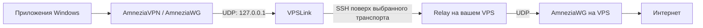

# VPSLink — Proof of Concept

Windows 11 x64 application that creates a local UDP bridge to **your own existing AmneziaWG server**, using SSH and optional WARP MASQUE / HTTPS transport. You keep using AmneziaVPN as the VPN client.

**Экспериментальный Proof of Concept.** Проверен в ограниченном наборе Windows/VPS-сред. Не гарантирует работу у любого провайдера, анонимность, отсутствие утечек или обход всех блокировок. Это самостоятельный проект, не официальный продукт Amnezia, Cloudflare или zapret.

## Для чего

Если прямое подключение к вашему VPS не работает, Link может передать UDP-пакеты AmneziaWG через другой доступный путь. В комплект входят отдельные процессы [usque](https://github.com/Diniboy1123/usque) для WARP MASQUE и [winws из zapret](https://github.com/bol-van/zapret) для выбранной стратегии обработки трафика. Системный клиент Cloudflare One не обязателен для этого режима.

Внешний SSH может идти напрямую, через SOCKS5/HTTP CONNECT, встроенный WARP MASQUE или аутентифицированный HTTPS/WebSocket-шлюз. Для постоянного шлюза используется Cloudflare Tunnel. Подробности, границы шифрования и ограничения TCP описаны в [архитектуре](docs/architecture.md).

## Что понадобится

| Компонент | Назначение |
|---|---|
| Windows 11 x64 | Компьютер пользователя; Windows ARM в этой сборке не поддерживается |
| Собственный Linux VPS с SSH и Python 3.8+ | Сервер с уже работающим AmneziaWG; для мастера шлюза нужны Linux x64, systemd и root |
| AmneziaVPN с поддержкой версии AmneziaWG на VPS | Отдельный VPN-клиент, устанавливается пользователем |
| Первый доступный путь управления VPS | Нужен для первоначальной настройки; полностью недоступный сервер нельзя настроить без такого пути |
| Домен в активной зоне Cloudflare и аккаунт Cloudflare | Только для постоянного HTTPS/WebSocket-шлюза |

VPS и домен приобретаются у выбранных вами провайдеров. AmneziaVPN доступна на [amnezia.org](https://amnezia.org); установка серверного VPN описана в [официальной документации](https://docs.amnezia.org). Link **не устанавливает AmneziaWG на пустой VPS**: он обнаруживает существующий VPN и может создать отдельного клиента. Режим WARP требует регистрации устройства и принятия условий Cloudflare в интерфейсе.

## Установка и работа

1. Скачайте `VPSLink-0.3.1-Setup.exe` из [Releases](https://github.com/JOOOOOJA/VPSLink/releases). Сравните SHA-256 с `SHA256SUMS.txt`. Установщик пока не подписан сертификатом издателя.
2. Откройте Link, добавьте VPS, укажите данные SSH. Проверенный ED25519-отпечаток возьмите из доверенной консоли сервера/хостера.
3. Нажмите **Подключить**. Если понадобится WinDivert, подтвердите запрос администратора. Выберите или создайте клиента на найденном AmneziaWG.
4. Сохраните VPN-профиль, один раз импортируйте его в AmneziaVPN и включите после готовности моста. В дальнейшем используйте тот же профиль и локальный порт.
5. Нажмите **Проверить интернет**. Готовность моста, рукопожатие VPN и успешный HTTPS-запрос — разные проверки.

Обычный режим — **ручной**: Link → «Подключить» → AmneziaVPN. Для отключения сначала выключите профиль AmneziaVPN, затем мост Link. Автозапуск не требуется. Не запускайте одновременно исходный профиль и его копию с одним ключом.

Для постоянного шлюза откройте «Подключение → Постоянный шлюз…». Используйте свой свободный поддомен, например `link.example.com`; [права токена и изменения на VPS](docs/server-changes.md). Общего сервера, общего домена, встроенных ключей или регистрации WARP для всех пользователей в приложении нет.

## Ограничения 0.3.1

- Совместимость с блокировками зависит от сети; одна встроенная стратегия winws не универсальна. Если уже запущен любой winws, Link не запускает второй экземпляр.
- Системный WARP и полный профиль AmneziaVPN могут конфликтовать. Не считайте их одновременную работу гарантированным резервом.
- UDP переносится через SSH/TCP: возможны задержки и падение скорости при потерях. Это не замена нативному UDP-транспорту для всех сценариев.
- **Нет собственного kill switch.** Маршруты устанавливает AmneziaVPN. IPv6 и утечки нужно проверять отдельно; рабочий IPv6-выход этой версией не подтверждён.
- Внешний IPv4-адрес MASQUE исключается из маршрутов VPN, чтобы транспорт не зациклился. Это намеренное исключение, а не обещание «каждый пакет через VPS».
- Для настройки VPS нужны существенные права SSH. Перед первым тестом сохраните доступ к консоли хостера и резервные копии настроек.

## Обновления

Раздел «Обновления» проверяет **этот репозиторий**. Канал PoC включает предварительные релизы. Автоматическая проверка не устанавливает обновление сама: пользователь скачивает проверенный пакет, отключает VPN/мост и подтверждает установку. Setup обновляет существующую копию без предварительного удаления и сохраняет профили. [Подробности](docs/updates.md).

## Документация и разработка

- [Архитектура и сетевые действия](docs/architecture.md)
- [Что меняется на VPS](docs/server-changes.md)
- [Хранение данных и модель угроз](docs/security-model.md)
- [Сборка, проверки и воспроизводимость](docs/build.md)
- [Сторонние компоненты и исходники](THIRD_PARTY_NOTICES.md)
- [Изменения 0.3.1](CHANGELOG.md), [план развития](docs/roadmap.md)
- [Сообщение об уязвимости](SECURITY.md), [участие в разработке](CONTRIBUTING.md)

Не прикладывайте к issues файлы `.conf`, `profiles.json`, WARP `config.json`, ключи, токены, полные журналы или снимки экрана с личными данными. Сначала удалите адреса ваших серверов и идентификаторы аккаунтов.

## Лицензия и благодарности

Собственный код — [MIT](LICENSE). Сторонние компоненты имеют собственные лицензии; они не перелицензируются MIT. См. [THIRD_PARTY_NOTICES.md](THIRD_PARTY_NOTICES.md) и каталог [LICENSES](LICENSES). Архив исходников сторонних компонентов размещается рядом с бинарным релизом.

Проект использует работы разработчиков [zapret](https://github.com/bol-van/zapret), [usque](https://github.com/Diniboy1123/usque), [WinDivert](https://github.com/basil00/WinDivert), Cygwin, Go, .NET и Cloudflare Tunnel. Для VPN необходим совместимый клиент [AmneziaVPN](https://github.com/amnezia-vpn/amnezia-client); его исходники и бинарники в Link не включены. Названия и товарные знаки принадлежат соответствующим владельцам.
